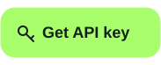
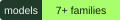

<div align="center">

<a href="https://routerhub.si/?utm_source=github&utm_medium=readme&utm_campaign=uncensored-vs-abliterated-ai">
  
</a>

# Uncensored vs Abliterated AI — Which Model Should You Use?

**Uncensored vs abliterated AI models explained with real RouterHub model IDs, published prices, refusal behavior, and practical model-by-model comparisons.**

<p align="center">
  <a href="https://routerhub.si/?utm_source=github&utm_medium=readme&utm_campaign=uncensored-vs-abliterated-ai"></a>
  <a href="https://t.me/routerhubsi"></a>
  <a href="https://routerhub.si/register?next=onboarding&utm_source=github&utm_medium=readme&utm_campaign=uncensored-vs-abliterated-ai"></a>
</p>

[](https://routerhub.si/models?utm_source=github&utm_medium=readme&utm_campaign=uncensored-vs-abliterated-ai)
[](#quickstart)
[](#pricing)
[](#pricing)
[](#pricing)

[**Browse models and pricing →**](https://routerhub.si/models?utm_source=github&utm_medium=readme&utm_campaign=uncensored-vs-abliterated-ai) · [Quick answer](#quick-answer) · [Model comparisons](#model-by-model) · [Docs](#documentation)

</div>

<p align="center"><strong>RouterHub is live:</strong> the model catalogue, published prices and API access are at <a href="https://routerhub.si/?utm_source=github&utm_medium=readme&utm_campaign=uncensored-vs-abliterated-ai">routerhub.si</a>.</p>

---

## Quick answer

**Abliterated** means the model weights were modified to reduce the refusal direction. **Uncensored** is the broader product outcome: a model that refuses less often, whether through weight changes, fine-tuning, a prompt-level persona, or a different alignment recipe.

In the current RouterHub catalogue, the **uncensored** entries are often cheaper than the **abliterated** entries for the same model family. If prompt-level control is enough for your use case, uncensored can be the better value. If you need a weight-level intervention, choose abliterated — and test it.

> **Important:** “abliterated” is not a guarantee of zero refusals, and “uncensored” is not a guarantee of unrestricted output. Behaviour depends on the exact model ID, prompt and provider policy.

---

## Uncensored vs abliterated — the difference

| | Abliterated | Uncensored |
|---|---|---|
| **What it describes** | A weight-level technique | An observable behavior or product category |
| **How it is produced** | Refusal-direction modification | Fine-tuning, data curation, merging, abliteration or prompting |
| **What changes** | Model weights | The model, the wrapper, or the prompt policy |
| **Typical benefit** | More consistent refusal reduction below the prompt layer | Lower cost in several current entries; prompt-level control may be enough |
| **Main risk** | Side effects on tone, instruction following or tool use | The recipe is not always visible; behavior still varies |
| **How to verify** | Test the exact model ID | Test the exact model ID |

Read the full definitions: [What is uncensored vs abliterated?](./docs/01-what-is-uncensored-vs-abliterated.md)

---

## The practical argument for uncensored

For several model pairs on RouterHub, the **uncensored ID costs less** than the abliterated ID:

- DeepSeek V4.1 Flash: uncensored is half the input price and less than half the output price.
- DeepSeek V4 Pro: uncensored is half the input price and one quarter the output price.
- GLM 5.3 and GLM 5.3 Flash: uncensored is cheaper on input and output.

If a well-structured system prompt, clear context and the right output format solve the refusal problem, **uncensored can be the same or better for your workload at a lower cost**. That is a real advantage — but it is not universal. Qwen 3.8 Max Uncensored, for example, is priced above the standard Qwen 3.8 Max entry.

Use the comparisons below, then test on your own prompts.

---

## Model-by-model comparisons

All prices are **USD per million tokens**, published in the RouterHub catalogue on **2026-10-27**. Always re-check [the live models page](https://routerhub.si/models) before deploying.

### DeepSeek V4.1 Flash Abliterated vs Uncensored

| | Abliterated | Uncensored |
|---|---|---|
| **API ID** | `deepseek-v4.1-flash-abliterated` | `deepseek-v4.1-flash-uncensored` |
| **Input** | $0.30 | $0.15 |
| **Output** | $1.25 | $0.60 |
| **Cached input** | $0.055 | $0.0026906 |
| **Protocol** | Chat Completions | Chat Completions |

The uncensored entry is **2× cheaper on input**, about **2.08× cheaper on output**, and much cheaper on cached input. Choose abliterated if you specifically need the weight-level variant; choose uncensored when cost and prompt-level control matter more.

### DeepSeek V4 Pro Abliterated vs Uncensored

| | Abliterated | Uncensored |
|---|---|---|
| **API ID** | `deepseek-v4-pro-abliterated` | `deepseek-v4-pro-uncensored` |
| **Input** | $0.40 | $0.20 |
| **Output** | $1.60 | $0.40 |
| **Cached input** | $0.04 | $0.0016 |
| **Protocol** | Chat Completions | Chat Completions |

DeepSeek V4 Pro Abliterated is an **operator-named alias retaining the DeepSeek V4.1 Flash abliterated upstream**, not a distinct Pro checkpoint. The uncensored Pro entry is **2× cheaper on input** and **4× cheaper on output**.

### GLM 5.3 Abliterated vs Uncensored

| | Abliterated | Uncensored |
|---|---|---|
| **API ID** | `glm-5.3-abliterated` | `glm-5.3-uncensored` |
| **Input** | $0.40 | $0.20 |
| **Output** | $1.33333333 | $0.62857143 |
| **Cached input** | $0.16 | $0.11659199 |
| **Protocol** | Chat Completions | Chat Completions |

The uncensored entry is **half the input price** and roughly **2.12× cheaper on output**. Cached input is closer, but uncensored is still lower.

### GLM 5.3 Flash Abliterated vs Uncensored

| | Abliterated | Uncensored |
|---|---|---|
| **API ID** | `glm-5.3-flash-abliterated` | `glm-5.3-flash-uncensored` |
| **Input** | $0.30 | $0.15 |
| **Output** | $1.00 | $0.50 |
| **Cached input** | $0.12 | $0.013453 |
| **Protocol** | Chat Completions | Chat Completions |

The uncensored Flash entry is **half the input price**, **half the output price**, and about **8.9× cheaper on cached input**.

### DeepSeek V4.1 Flash Abliterated vs GLM 5.3 Flash Abliterated

| | DeepSeek V4.1 Flash Abliterated | GLM 5.3 Flash Abliterated |
|---|---|---|
| **API ID** | `deepseek-v4.1-flash-abliterated` | `glm-5.3-flash-abliterated` |
| **Input** | $0.30 | $0.30 |
| **Output** | $1.25 | $1.00 |
| **Cached input** | $0.055 | $0.12 |
| **Protocol** | Chat Completions | Chat Completions |

Same input price. GLM is cheaper on output; DeepSeek is cheaper on cached input. Choose on task quality and cache behavior, not the label alone.

### DeepSeek V4.1 Flash Uncensored vs GLM 5.3 Flash Uncensored

| | DeepSeek V4.1 Flash Uncensored | GLM 5.3 Flash Uncensored |
|---|---|---|
| **API ID** | `deepseek-v4.1-flash-uncensored` | `glm-5.3-flash-uncensored` |
| **Input** | $0.15 | $0.15 |
| **Output** | $0.60 | $0.50 |
| **Cached input** | $0.0026906 | $0.013453 |
| **Protocol** | Chat Completions | Chat Completions |

Same input price. GLM is cheaper on output; DeepSeek is much cheaper on cached input.

### DeepSeek V4.1 Flash Uncensored vs GLM 5.3 Uncensored

| | DeepSeek V4.1 Flash Uncensored | GLM 5.3 Uncensored |
|---|---|---|
| **API ID** | `deepseek-v4.1-flash-uncensored` | `glm-5.3-uncensored` |
| **Input** | $0.15 | $0.20 |
| **Output** | $0.60 | $0.62857143 |
| **Cached input** | $0.0026906 | $0.11659199 |
| **Protocol** | Chat Completions | Chat Completions |

DeepSeek is cheaper on all three published rates, with the largest difference on cached input.

### Qwen 3.8 Max Uncensored vs standard Qwen 3.8 Max

| | Standard | Uncensored |
|---|---|---|
| **API ID** | `qwen3.8-max` | `qwen3.8-max-uncensored` |
| **Input** | $0.20 | $0.25 |
| **Output** | $0.60 | $0.75 |
| **Cached input** | $0.025 | $0.03125 |
| **Protocol** | Chat Completions | Chat Completions |

Qwen 3.8 Max Uncensored is **25% more expensive** than the standard entry on all three rates. There is no Qwen abliterated entry in the current catalogue, so the choice is standard vs uncensored.

---

## When to use abliterated

- You need a **weight-level** intervention, not just a prompt-level persona.
- Standard prompts still hit refusals in legitimate research, creative or agent workflows.
- You can accept possible changes in tone, instruction following or tool-call behavior.
- You will test quality, not only whether one blocked prompt gets answered.

## When to use uncensored

- You want the **lower-cost** entry for the same family.
- Your prompt structure, system instructions and output format already control the interaction well.
- You are willing to verify the exact catalogue entry and test refusal behavior.
- You want a broader product label that may be implemented through different recipes.

## How to phrase requests better

Before paying more for an abliterated model, improve the prompt:

1. **Set the role and task clearly.** Say what the model is doing, for whom, and why.
2. **Give context.** Provide the source, constraints and intended output.
3. **Specify format.** Ask for a table, JSON shape or bullet list.
4. **Use a normal fallback.** If a request is ambiguous, ask the model to explain the ambiguity instead of triggering a refusal.
5. **Test the exact model ID.** A cheaper uncensored entry may work better than an expensive abliterated entry for your prompts.

Prompt phrasing is not a guarantee. If the refusal happens below the prompt layer, use an abliterated entry or a different model.

---

## Pricing

| Model | API ID | Input / 1M | Output / 1M | Cached / 1M |
|---|---|---:|---:|---:|
| DeepSeek V4.1 Flash | `deepseek-v4.1-flash` | $0.10 | $0.40 | $0.0026906 |
| DeepSeek V4.1 Flash Abliterated | `deepseek-v4.1-flash-abliterated` | $0.30 | $1.25 | $0.055 |
| DeepSeek V4.1 Flash Uncensored | `deepseek-v4.1-flash-uncensored` | $0.15 | $0.60 | $0.0026906 |
| DeepSeek V4 Pro | `deepseek-v4-pro` | $0.15 | $0.30 | $0.0016 |
| DeepSeek V4 Pro Abliterated | `deepseek-v4-pro-abliterated` | $0.40 | $1.60 | $0.04 |
| DeepSeek V4 Pro Uncensored | `deepseek-v4-pro-uncensored` | $0.20 | $0.40 | $0.0016 |
| GLM 5.3 | `glm-5.3` | $0.15 | $0.47142857 | $0.11659199 |
| GLM 5.3 Abliterated | `glm-5.3-abliterated` | $0.40 | $1.33333333 | $0.16 |
| GLM 5.3 Uncensored | `glm-5.3-uncensored` | $0.20 | $0.62857143 | $0.11659199 |
| GLM 5.3 Flash | `glm-5.3-flash` | $0.10 | $0.33333333 | $0.013453 |
| GLM 5.3 Flash Abliterated | `glm-5.3-flash-abliterated` | $0.30 | $1.00 | $0.12 |
| GLM 5.3 Flash Uncensored | `glm-5.3-flash-uncensored` | $0.15 | $0.50 | $0.013453 |
| Qwen 3.8 Max | `qwen3.8-max` | $0.20 | $0.60 | $0.025 |
| Qwen 3.8 Max Uncensored | `qwen3.8-max-uncensored` | $0.25 | $0.75 | $0.03125 |

Published RouterHub rates, checked 2026-10-27. Prices can change.

---

## Quickstart

```bash
export ROUTERHUB_API_KEY="sk-..."
export ROUTERHUB_BASE_URL="https://.../v1"
```

```python
import os
from openai import OpenAI

client = OpenAI(
    api_key=os.environ["ROUTERHUB_API_KEY"],
    base_url=os.environ["ROUTERHUB_BASE_URL"],
)

response = client.chat.completions.create(
    model="MODEL_ID_FROM_DASHBOARD",
    messages=[
        {"role": "system", "content": "You are a precise research assistant."},
        {"role": "user", "content": "Compare these two model choices for my workload: ..."},
    ],
)
print(response.choices[0].message.content)
```

The DeepSeek, GLM and Qwen entries above use **Chat Completions**. Confirm the supported protocol for the exact model ID in the [catalogue](https://routerhub.si/models).

Full setup: [API quickstart](./docs/09-api-quickstart.md).

---

## How to evaluate them

1. Build a prompt set with normal tasks, edge cases and previously blocked prompts.
2. Test the exact model ID, not the label.
3. Score refusal, quality, side effects and cost per successful task.
4. Re-test after catalogue updates.
5. Choose the cheapest model that passes your quality bar.

Full guide: [Evaluating uncensored vs abliterated models](./docs/07-evaluation.md).

---

## FAQ

**Is uncensored better than abliterated?**

Not universally. In the current RouterHub catalogue, uncensored entries are often cheaper. Abliterated entries use a weight-level intervention. The better choice depends on whether prompt-level control is enough and how the exact model behaves on your tasks.

**Why is uncensored cheaper?**

Pricing is set per model entry. Current RouterHub prices show lower input/output rates for several uncensored entries, but not all — Qwen 3.8 Max Uncensored is more expensive than standard Qwen 3.8 Max.

**Does abliterated guarantee no refusals?**

No. Abliteration reduces the refusal direction; it does not eliminate every refusal. Behaviour varies by model, prompt and provider policy.

**Can I use uncensored for the same tasks as abliterated?**

Often yes, if your prompts are clear and your quality tests pass. Test both when a refusal or a quality issue matters.

**Which DeepSeek should I choose?**

For cost, compare `deepseek-v4.1-flash-uncensored` with `deepseek-v4.1-flash-abliterated`. The uncensored entry is cheaper; the abliterated entry is the weight-level option.

**Which GLM should I choose?**

Compare `glm-5.3-uncensored`, `glm-5.3-flash-uncensored`, `glm-5.3-abliterated` and `glm-5.3-flash-abliterated`. Flash entries are cheaper; uncensored entries are usually cheaper than their abliterated counterparts.

**Is there a Qwen abliterated model?**

No Qwen abliterated entry appears in the current RouterHub catalogue. The comparison is standard Qwen 3.8 Max vs Qwen 3.8 Max Uncensored.

**Does RouterHub offer one API key for all of them?**

Yes — one prepaid key covers the supported catalogue. Check the exact model ID and protocol before sending requests.

**Can I use these with Claude Code, Cursor or OpenCode?**

Use a supported protocol for the exact entry. DeepSeek, GLM and Qwen entries listed here use Chat Completions; Claude Code generally needs an Anthropic Messages-compatible entry.

---

## Documentation

| Guide | What it covers |
|---|---|
| [What is uncensored vs abliterated?](./docs/01-what-is-uncensored-vs-abliterated.md) | Definitions and the real difference |
| [How to choose](./docs/02-how-to-choose.md) | Cost, refusals, quality and workflow |
| [DeepSeek comparisons](./docs/03-deepseek-comparisons.md) | Flash and Pro pairs |
| [GLM comparisons](./docs/04-glm-comparisons.md) | GLM 5.3 and Flash pairs |
| [Cross-family comparisons](./docs/05-cross-family-comparisons.md) | DeepSeek vs GLM vs Qwen |
| [Pricing and cost per success](./docs/06-pricing-and-cost.md) | Published rates and retry costs |
| [Evaluation](./docs/07-evaluation.md) | Refusal, quality and side effects |
| [Prompting and refusals](./docs/08-prompting-and-refusals.md) | Better prompts before paying more |
| [API quickstart](./docs/09-api-quickstart.md) | Key, base URL, first request |
| [FAQ](./docs/10-faq.md) | Long-form answers |
| [Safety](./docs/11-safety.md) | Lawful use and guardrails |
| [Glossary](./docs/12-glossary.md) | Abliteration, uncensored, tokens |
| [Model ID map](./docs/13-model-id-map.md) | Every compared ID and price |
| [Troubleshooting](./docs/14-troubleshooting.md) | Auth, model IDs, protocols |

---

## Related

- [Uncensored AI API](https://github.com/routerhubSI/uncensored-ai-api) — category hub.
- [GLM 5.3 guide](https://github.com/routerhubSI/glm-5.3-abliterated) — GLM models and prompt collection.
- [RouterHub](https://routerhub.si/?utm_source=github&utm_medium=readme&utm_campaign=uncensored-vs-abliterated-ai) — model catalogue and API access.
- [Telegram](https://t.me/routerhubsi) — updates and support.

---

<div align="center">

**Star this repository if it helped you choose between uncensored and abliterated models.**

<sub>RouterHub is an independent AI API gateway. Model names and trademarks belong to their respective owners. Prices and availability are shown in the RouterHub catalogue and can change. Use responsibly and follow the laws and terms that apply to you.</sub>

</div>
